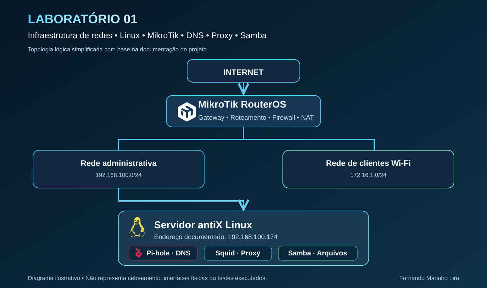

# 🐧 Laboratório 01 — Infraestrutura de Redes com Linux, MikroTik, Pi-hole, Squid e Samba

**Portfólio técnico | Administração de servidores • Redes • DNS • Proxy • Compartilhamento de arquivos**

[](./Portfolio_Infraestrutura_Redes_Fernando_Marinho_CORRIGIDO.pdf)
[](https://antixlinux.com/)


> **Escopo e transparência:** esta página organiza o conteúdo **já descrito na documentação existente**. O diagrama abaixo é uma **representação lógica simplificada**, não um desenho físico ou uma validação em tempo real. Comandos e verificações citados representam procedimentos documentados ou passíveis de validação; **não são novos testes executados nesta atualização**.

## 📑 Navegação

- [1. Visão geral](#1--visão-geral)
- [2. Cenário e arquitetura](#2--cenário-e-arquitetura)
- [3. Tecnologias e responsabilidades](#3--tecnologias-e-responsabilidades)
- [4. Componentes do laboratório](#4--componentes-do-laboratório)
- [5. Matriz de verificações](#5--matriz-de-verificações)
- [6. Documentação disponível](#6--documentação-disponível)
- [7. Evolução e pendências](#7--evolução-e-pendências)
- [8. Autor](#8--autor)

## 1. 🎯 Visão geral

Este laboratório documenta uma infraestrutura de rede que reúne **MikroTik RouterOS** no papel de gateway e políticas de rede e **antiX Linux** como servidor para serviços de **Pi-hole (DNS)**, **Squid Proxy (navegação)** e **Samba (arquivos)**.

O cenário foi descrito com os objetivos de centralizar serviços, aplicar controle de acesso, dar visibilidade às consultas e registros de tráfego e aproveitar recursos computacionais de baixo custo.

**Competências abordadas:** administração Linux via terminal/SSH; endereçamento IP; roteamento; firewall/NAT; DNS; proxy; compartilhamentos; análise de logs e troubleshooting.

## 2. 🗺️ Cenário e arquitetura

### Informações registradas na documentação

| Elemento | Identificação ou papel documentado |
|---|---|
| Acesso externo | Internet conectada ao gateway MikroTik |
| Gateway | MikroTik RouterOS — roteamento, firewall e NAT |
| Rede administrativa | `192.168.100.0/24` |
| Rede de clientes Wi-Fi | `172.16.1.0/24` |
| Servidor de serviços | antiX Linux — `192.168.100.174` |
| Serviços descritos | Pi-hole, Squid Proxy e Samba |

### Topologia lógica simplificada



[🔍 Abrir diagrama em tamanho completo](./topologia-lab-01.svg)

**Sobre as marcas:** o diagrama incorpora os ícones vetoriais de **Linux**, **MikroTik** e **Pi-hole** da coleção [Simple Icons](https://simpleicons.org/). **Squid e Samba** aparecem identificados por seus nomes, sem utilizar logotipos não verificados. A imagem é uma representação lógica simplificada com base nos dados já documentados.

**Como interpretar:** o desenho mostra a relação funcional entre gateway, redes e serviços. Não estabelece o número de interfaces, switches, pontos de acesso, portas físicas ou regras exatas de encaminhamento. Os clientes que utilizam DNS/proxy e as políticas aplicadas devem ser confirmados nas configurações reais antes de reproduzir o ambiente.

## 3. 🛠️ Tecnologias e responsabilidades

| Tecnologia | Papel descrito |
|---|---|
| **antiX Linux** | Sistema operacional do servidor de serviços |
| **MikroTik RouterOS** | Roteamento, políticas de firewall e NAT |
| **Pi-hole** | Resolução e filtragem de consultas DNS |
| **Squid Proxy** | Controle de navegação, cache e registros |
| **Samba** | Compartilhamentos, usuários e permissões |
| **TCP/IP e DHCP** | Endereçamento, conectividade e distribuição de parâmetros |
| **Logs e ferramentas de diagnóstico** | Inspeção e troubleshooting dos serviços |

## 4. ⚙️ Componentes do laboratório

### 4.1 MikroTik — rede, firewall e NAT

A documentação aborda o papel do MikroTik como gateway e a análise de políticas de acesso, encaminhamento de tráfego, NAT e separação lógica de clientes. Também registra o cuidado necessário com **redirecionamentos DNS** e possíveis loops de resolução.

**Artefatos a incluir futuramente:** trechos de exportação do RouterOS **sanitizados**, com comentários explicativos sobre as regras efetivamente utilizadas.

### 4.2 Pi-hole — DNS e filtragem

O Pi-hole é apresentado como serviço DNS para clientes definidos na arquitetura, com bloqueio de domínios e possibilidade de consultar registros de consultas e filtros.

**Artefatos a incluir futuramente:** captura do painel sem dados sensíveis, configuração efetiva dos encaminhadores DNS e evidências de resolução/bloqueio.

### 4.3 Squid Proxy — controle de navegação

O Squid é tratado como serviço de proxy com políticas de acesso, cache, filtros e análise de log. O caminho de log mencionado no material é:

```text
/var/log/squid/access.log
```

**Artefatos a incluir futuramente:** configuração `squid.conf` revisada, exemplos anonimizados de log e evidências de uma política testada.

### 4.4 Samba — arquivos e permissões

A documentação inclui compartilhamentos, usuários, grupos, controle de permissões e a referência ao comando de análise de configuração:

```bash
testparm -s
```

**Artefatos a incluir futuramente:** arquivo `smb.conf` anonimizado, matriz de permissões e evidência de acesso autorizado/negado.

### 4.5 Diagnóstico e monitoramento

Os procedimentos documentados mencionam análise de logs e ferramentas como `ping`, `traceroute`, `nslookup`, `curl`, `ss` e `systemctl`.

**Importante:** **Zabbix, Grafana e Netdata** são citados apenas como **possibilidades de evolução**. Esta página **não afirma que essas ferramentas foram implantadas**.

## 5. 🧪 Matriz de verificações

Esta matriz organiza como o laboratório **pode ser validado** e o que deve ser registrado. **Não há novos resultados atribuídos a esses testes.**

| Camada | Verificação sugerida | Evidência necessária | Situação neste README |
|---|---|---|---|
| Rede | Conectividade entre cliente, gateway e servidor | Comandos e saídas com data | A documentar |
| DNS | Resolução de nomes e bloqueio planejado no Pi-hole | Consultas e registros anonimizados | A documentar |
| Proxy | Aplicação de política de acesso no Squid | Configuração e log correspondente | A documentar |
| Arquivos | Acesso permitido e negado em compartilhamentos | Permissões e teste de cliente | A documentar |
| Firewall/NAT | Caminho de tráfego e regras específicas | Exportação sanitizada e verificação | A documentar |
| Serviços Linux | Estado dos serviços e registros de diagnóstico | Saídas de comandos/serviços | A documentar |

*“A documentar” significa que esta página ainda não apresenta uma evidência verificável para cada cenário; não significa que a atividade nunca tenha ocorrido.*

## 6. 📚 Documentação disponível

| Documento | Conteúdo/uso |
|---|---|
| **[Portfólio de infraestrutura de redes — PDF](./Portfolio_Infraestrutura_Redes_Fernando_Marinho_CORRIGIDO.pdf)** | Documento principal de apresentação técnica, topologia, exemplos e descrições |
| **[Projeto de infraestrutura Linux — PDF](./Projeto_Infraestrutura_Linux_Portfolio.pdf)** | Material complementar já publicado no laboratório |
| **[README geral do repositório](../README.md)** | Índice dos laboratórios de infraestrutura Linux |

> **Pendência editorial já identificada:** o PDF principal contém duas páginas sobre monitoramento e requer uma revisão final da numeração e do conteúdo. Os PDFs **não foram alterados** nesta atualização.

## 7. 🧭 Evolução e pendências

As melhorias planejadas para tornar este laboratório mais reproduzível são:

1. Revisar a versão final dos PDFs e eliminar duplicidades editoriais.
2. Confrontar a topologia lógica com a configuração real e produzir um diagrama validado.
3. Adicionar arquivos de configuração **somente após anonimização** e revisão de segurança.
4. Acrescentar testes reproduzíveis com evidências e resultados reais.
5. Registrar versões dos softwares, decisões de arquitetura e limitações observadas.

Nenhuma dessas etapas é declarada como concluída apenas por constar nesta lista.

## 8. 👤 Autor

**Fernando Marinho Lira**  
Infraestrutura de TI | Linux | Redes | MikroTik | Microsoft Azure  
**Certificação:** Microsoft Azure Fundamentals (AZ-900)

[GitHub](https://github.com/Fernando-Marinho-Lira) · [LinkedIn](https://www.linkedin.com/in/fernando-marinho-lira/)

---

**Nota de segurança:** nunca publique senhas, tokens, IPs públicos de ambientes produtivos, dados de clientes ou exportações completas sem revisão. Os endereços privados aqui apresentados são os já informados na documentação pública do laboratório.
